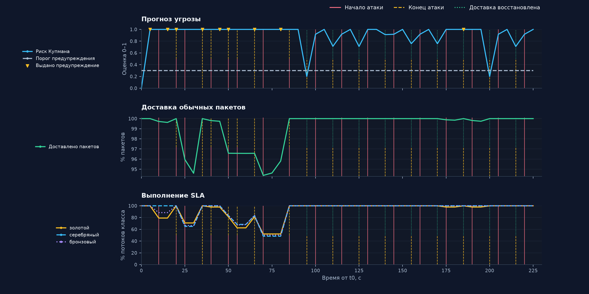

# GNet9 — прогноз угроз безопасности сети

Программа показывает работу сети во времени: передачу данных, появление
угрозы, прогноз и рекомендации человеку. Структура сети, маршруты и
серверы потоков фиксированы: автоматического управления, изоляции и
переключения на резерв нет. Сеть содержит 480 абонентов,
30 сетевых устройств, 4 сервера и 6 услуг. Исходное исправное состояние
`t0` уже имеет нагрузку и остаётся эталоном для всех последующих шагов.

## Как читать проект

Для первого запуска выполните [установку](#установка-и-первый-запуск).
В готовом окружении выберите команду по нужному результату.

| Что посмотреть | Команда | Что открыть |
|---|---|---|
| Исправная сеть, обучение и качество услуг | `python main.py --reports-only` | `output/reports/run_summary.md` |
| Прогноз угроз и рекомендации оператору | `python main.py --reports-only --attack-scenario predictive-demo` | `output/reports/run_summary.md` |
| Прогноз, трафик и наблюдённые атаки на графиках | `python main.py --attack-scenario predictive-demo` | `output/run_summary.md`, затем `output/charts/incident_overview.png` |
| Расчёты и правила для подробного разбора | `python main.py --reports-only --detailed-output --attack-scenario mitre-demo` | `output/reports/details/run_summary.md` |

Для прогона с атаками краткий отчёт показывает точность, полноту и ложные тревоги. В таблице событий указаны упреждение или пропуск для каждой атаки.
Для просмотра по шагам используйте `output/step_log.csv` или окно `--show-window`.

Для сравнения во времени откройте `output/charts/incident_overview.png`. Сверху
видны риск, порог и выданные предупреждения, посередине — доставка обычных
пакетов, снизу — доля потоков каждого класса, выполнивших требования SLA.
Подписи слева показывают минимальную доставку и худший результат каждого
класса. Если значение менялось, рядом указана секунда первого минимума.
Вертикали начала и конца атак на временных графиках стоят в одних координатах. Красная
сплошная отмечает первое наблюдение атаки, оранжевая штриховая — первый шаг
после её окончания, зелёная пунктирная — подтверждённое восстановление
доставки. Какие события затронули конкретный узел, видно в
`output/charts/event_timeline.png`. Зелёная полоса показывает интервалы, принятые
в обучение Купмана, синяя — поступление обычных абонентских пакетов.
Красные полосы показывают, когда наблюдалась каждая атака и какой узел был её целью.
На графиках SLA рядом с классом указано число учтённых абонентских потоков.
`output/charts/arbitrator_signals.png` сопоставляет четыре сигнала с фактической рекомендацией оператору в тот же момент.

Для разбора математики см. [путь данных и план разбора для защиты](doc/full_project_explanation_ru.md#как-разобраться-в-проекте)
и [карту исходных файлов](doc/full_project_explanation_ru.md#структура-проекта-и-карта-файлов).
Математические разделы того же документа объясняют формулы и допущения.
[AGENTS.md](AGENTS.md) задаёт правила изменения и проверки кода.

## Как GNet9 соотносится с архитектурными схемами

Обе схемы описывают путь от телеметрии до решения оператора. GNet9
воспроизводит этот путь в симуляции. Состояние исправной сети `t0`, маршруты
и серверы потоков остаются фиксированными на весь прогон.

| Блок схем | Как работает в GNet9 |
|---|---|
| Телеметрия L0–L8 и тензор пятого порядка | Модель формирует снимки уровней и линий в памяти. Пять осей (объект, уровень, связь, показатель, время) представлены разреженно, отдельными таблицами снимков. gNMI, SNMP, NetFlow и Syslog относятся к внешнему контуру. CSV проверяет порог на готовом ряде риска. |
| Калман и порог 24,7 | Локальная оценка рассчитывается для каждой вершины и линии. Фильтр пропускает обновление при квадрате махаланобисовой невязки > 24,7 (расхождение с учётом шума). Сырое значение остаётся в диагностике. Окно обновляется по таймеру в 10 шагов, по смене наблюдаемого режима и по ковариации (мере разброса невязок). |
| Геленбе, Вейбулл и Купман | Очереди дают нагрузку, потери, число пакетов и задержку. Вейбулл задаёт интервалы симуляции, а Купман строит прогноз по текущим и прошлым наблюдениям. В исправном режиме и `mitre-demo` шаг по умолчанию 5 с, в `predictive-demo` — 2 с. |
| ΔS, маски и MITRE ATT&CK | Для 11 техник используются взвешенные маски Адамара размером 14×8 (группы признаков × шаги наблюдения). После проверки обязательных признаков модель сравнивает гипотезы по наблюдениям датчика. Для пяти техник в расчёт входят числовые ориентиры из примеров MITRE, в том числе объём исходящей передачи за наблюдаемый интервал для T1041. Источники, единицы и допущения приведены в [описании масок](doc/full_project_explanation_ru.md#взвешенные-слепки-атак). Возможные техники записываются в `mitre_technique_candidates`. |
| Устойчивость и цепочка атаки | Диагностика включает локальное расстояние Хаусдорфа–Махаланобиса до `t0`, отдельное расстояние состояния для арбитра и изменение функции Ляпунова. Цепочка показывает наблюдаемые этапы и известные маршруты. Для произведения причинных матриц со схем нужны определения переходов между уровнями и данные для их оценки. |
| d0sl и выбор рекомендации | d0sl задаёт требования к качеству потоков. Для каждой меры сравниваются три заданных множителя нагрузки (0,72, 0,88 и 1,00). По критерию Вальда выбирается мера с наибольшим выигрышем в худшем случае. Ущерб учитывает нарушения SLA с весами Gold/Silver/Bronze 3/2/1. Порядок проверки услуг человеком начинается с Gold. |
| Тревоги, правила и действия | Панель показывает срочность, цепочку наблюдений, известный маршрут и рекомендации. В подробном режиме экспортируются Sigma и Suricata, а для безопасного образца T1204 — YARA. Интеграция с рабочими системами ИБ и применение мер относятся к внешнему контуру оператора. |

Для перегрузок `attack_family` задаёт DoS или DDoS по наблюдаемым точкам
входа, а `attack_mechanism` задаёт механизм. Так DoS (SYN flood) и
DDoS (SYN flood) используют одну технику T1499.001. Варианты DHCP используют
телеметрию нагрузки службы выдачи адресов и сопоставлены общей технике
перегрузки службы T1499.002. [SYN в MITRE ATT&CK](https://attack.mitre.org/techniques/T1499/001/) · [Перегрузка службы в MITRE ATT&CK](https://attack.mitre.org/techniques/T1499/002/)

### Локальные правила наблюдения

`python main.py --attack-scenario mitre-demo --detailed-output` сохраняет в `output/details/detection_rules/`:

- `manifest.json` — число правил и причины пропуска форматов. В исправном прогоне сохраняется только этот файл.
- `gnet9.yml` и `observations.jsonl` — правила Sigma и журнал. Правила выбирают числовые гипотезы и классифицированные предвестники. Метки событий из сценария сохраняются отдельно для сверки. BGP отбирается по типу события. [Спецификация Sigma](https://sigmahq.io/sigma-specification/specification/sigma-rules-specification.html).
- `gnet9.rules` — правила Suricata с действием `alert` для наблюдавшихся целей SYN-flood. Порог равен минимальной положительной модельной частоте SYN для цели за этот прогон. Адреса и частоты относятся к стенду. [Формат правил Suricata](https://docs.suricata.io/en/latest/rules/intro.html).
- `gnet9.yar` и `user_execution_fixture.txt` — правило YARA и безвредный текстовый образец для проверки экспорта T1204. Правило распознаёт именно содержимое учебного образца. [Документация YARA](https://yara.readthedocs.io/en/stable/writingrules.html).

Правила формируются по прошедшим наблюдениям, отдельно от прогноза. Точка
входа на карте, в том числе у отражённого трафика, требует подтверждения
источника человеком перед ограничением доступа. [Расчёты и допущения](doc/full_project_explanation_ru.md#карта-состояний-и-рекомендации-человеку).

## Установка и первый запуск

Нужен Python 3.10 или новее. Команды для PowerShell в Windows:

```powershell
Set-Location D:\programming\9gnet
python -m venv .venv
.venv/Scripts/python.exe -m pip install --upgrade "pip>=26.3"
.venv/Scripts/python.exe -m pip install -r requirements.txt
.venv/Scripts/python.exe main.py
```

Создавать окружение и устанавливать библиотеки нужно при первом развёртывании;
повторные запуски начинаются с последней команды. Если окружение уже есть,
проверьте его командой `.venv/Scripts/python.exe tools/check.py doctor`.
В Linux и macOS используйте `python3 -m venv .venv`, затем `.venv/bin/python`.

Для нового окружения предпочтителен Python 3.11 или новее. В нём требования
выбирают Pillow 13 или новее с исправлениями обработки TIFF. На Python 3.10
доступна предыдущая ветка Pillow. Штатный запуск GNet9 создаёт PNG по данным
модели. [Изменения Pillow 13](https://pillow.readthedocs.io/en/stable/releasenotes/13.0.0.html) · [Описание исправления TIFF](https://github.com/advisories/GHSA-xcvg-w56q-r89m).

Далее `python` означает Python выбранного окружения. В PowerShell его можно
выбрать командой `. .venv/Scripts/Activate.ps1`. Если выполнение сценариев
отключено, используйте явный путь `.venv/Scripts/python.exe` вместо `python`
во всех примерах: менять системные настройки для запуска проекта не требуется.

## Режимы эксперимента

| Команда | Что происходит | Длительность по времени модели |
|---|---|---|
| `python main.py` | Исправная сеть, обычный трафик, без атак | 10 переходов по 5 с = 50 с |
| `python main.py --attack-scenario mitre-demo` | 18 фиксированных эпизодов, включая DoS и DDoS для SYN и DHCP. [Полный перечень](doc/full_project_explanation_ru.md#сценарии-атак-и-датчики) | 45 переходов по 5 с = 225 с |
| `python main.py --attack-scenario predictive-demo` | Обучение на норме, наблюдаемые предвестники, прогноз, атаки и рекомендации | 160 переходов по 2 с = 320 с; первая атака на шаге 70 |
| `python main.py --dynamics-steps 0` | Только `t0`, без последующих переходов | 0 с |
| `python main.py --no-packet-simulation` | Состояния без расчёта пакетных потоков | По выбранным шагам; для обзора структуры, без атак |
| `python main.py --validate-telemetry-csv observations.csv` | Отдельная проверка внешнего ряда, без запуска сети | Определяется временем в CSV |

Время модели отличается от времени ожидания расчёта на компьютере.
Есть `t0` и ещё N переходов: при `--dynamics-steps 100` получается 101 снимок.
Режим `mitre-demo` показывает фиксированные события; для проверки упреждения
и рекомендаций используйте `predictive-demo`.

### Готовые команды

```powershell
# Справка со всеми действующими параметрами.
python main.py --help

# Длиннее посмотреть исправную сеть и обучение на нормальном трафике.
python main.py --dynamics-steps 60 --step-seconds 2

# Прогноз и рекомендации с окном воспроизведения после расчёта.
python main.py --attack-scenario predictive-demo --show-window

# Повторяемый опыт с заданным началом и интервалом атак.
python main.py --attack-scenario predictive-demo --dynamics-steps 100 --step-seconds 2 --attack-start-step 50 --attack-interval-steps 10 --attack-seed 42

# Другой случайный ряд атак; нативный трафик сохраняет свой генератор.
python main.py --attack-scenario predictive-demo --attack-seed 7

# Подробности тензоров и отдельных потоков в JSON.
python main.py --attack-scenario predictive-demo --snapshot-detail tensor --packet-detail flows

# Полный граф каждого снимка и примеры пакетных записей: большой JSON.
python main.py --snapshot-detail full --packet-detail sample --packet-sample-limit 20

# Схема вызовов и журнал выполнения для разбора внутренней работы.
python main.py --debug-diagram
```

Счёт начинается с `t0`, то есть шага 0. Предвестник — наблюдаемые признаки
приближающейся угрозы — в `predictive-demo` появляется за 20 секунд до атаки.
Поэтому в примере с началом на шаге 50 шаги 1–39 используются для обучения
на исправной сети; с шага 40
признаки угрозы замораживают обучение, а само воздействие начинается на шаге 50.
Прогноз использует текущие и прошлые наблюдения. Обычный трафик следует
распределению Пуассона (правилу случайного числа поступлений за шаг).
Его наблюдения сглаживаются фильтром Калмана перед обучением Купмана;
признаки угрозы и нарушения требований к качеству услуг (SLA)
сохраняются без сглаживания.
Прогноз не воздействует на следующий шаг: человек получает наблюдаемые
цели, окно прогноза и перечень проверок и возможных мер в
`arbitrator.recommendation`, кратком отчёте и журнале шагов.
Перед тензорным прогнозом также подавляется обычный шум. В
`koopman.kalman_filter` сохраняются локальные оценки через разложение
Холецкого, сигма-точки наиболее изменившихся объектов и неопределённость
входа Купмана. Это расчётные оценки при заданных Q/R, а не гарантия точности
датчиков. Формулы и ограничения приведены в [описании расчётов](doc/full_project_explanation_ru.md#фильтр-калмана).

В стандартном `predictive-demo` до предвестников проходит 59 переходов:
118 секунд наблюдений. По плану это участок исправной сети, но пригодность
каждой пары всё равно проверяется по данным. Длинный участок нормы даёт
больше наблюдений; число шагов само по себе не гарантирует качество прогноза.

Без `--attack-interval-steps` сохраняются интервалы сценария. В режиме
`predictive-demo` они получаются по распределению Вейбулла (вероятностному
правилу времени ожидания): форма 1,5 для перегрузки, 0,7 для медленных
попыток входа. `--attack-seed 42` позволяет повторить выбор
событий. При явном начале сохраняются эти интервалы, меняется начало серии.
События за последним шагом не выполняются.

### Все параметры запуска

Числа ниже — значения по умолчанию, если параметр не указан.

| Время и события | Значение и смысл |
|---|---|
| `--attack-scenario none` | `none`, `mitre-demo`, `predictive-demo`; выбор сценария |
| `--dynamics-steps N` | Целое ≥ 0; 10 без атак, 45 для `mitre-demo`, 160 для `predictive-demo` |
| `--step-seconds S` | Целое > 0; 5, для `predictive-demo` — 2 секунды |
| `--attack-start-step N` | Целое > 0; явное начало первой атаки, после начала её предвестников |
| `--attack-interval-steps N` | Целое > 0; фиксированный интервал между началами, возможны перекрытия |
| `--attack-seed 42` | Начальное число для воспроизводимого сценария и округления потерь каждого потока. Для обычных поступлений используется отдельный генератор |
| `--prediction-lead-seconds N` | Целое > 0; требуемое упреждение для оценки прогноза: 10 с в `predictive-demo`, в остальных режимах — длительность шага |
| `--prediction-slo-seconds N` | Другое имя того же параметра упреждения |

Первая атака на шаге 70 назначается, когда в `predictive-demo` не указаны
ни `--dynamics-steps`, ни `--attack-start-step`. Если явно меняете длину
эксперимента, для управляемого начала задавайте также `--attack-start-step`.
Без этого сохраняется исходное расписание короткого сценария.
Минимальная длина `predictive-demo` — `max(2, ceil(20 / S)) + 5` шагов,
где S — длительность шага: при S=2 это 15. Такой минимум позволяет выполнить
сценарий, но не обеспечивает длительного обучения. Явное начало должно быть
позже участка предвестников и не позже последнего шага.

Требуемое упреждение оценивает, насколько заранее получен сигнал. Оно
не меняет горизонт прогноза Купмана, который рассчитывается отдельно до 20 с
вперёд с дискретностью шага. При S > 20 единственный будущий шаг выходит
за этот горизонт; для демонстрации предупреждений используйте S=2.

| Фильтр и детализация | Значение и смысл |
|---|---|
| `--kalman-process-variance 0.0001` | Q ≥ 0: дисперсия изменения нормированного состояния за шаг |
| `--kalman-measurement-variance 0.0025` | R > 0: дисперсия шума нормированного измерения |
| `--snapshot-detail summary` | `summary` — сводка, `tensor` — также значения тензоров, `full` — также граф каждого снимка |
| `--packet-detail summary` | `summary` — итоги, `flows` — также отдельные потоки, `sample` — также показательные пакетные записи |
| `--packet-sample-limit 48` | Целое ≥ 0; предел числа показательных записей на снимок при сохранении примеров |
| `--no-packet-simulation` | Отключить пакетную модель; несовместимо с атаками и `--show-window` |
| `--reports-only` | Сохранить отчёт и журнал в `output/reports/` без графиков |
| `--detailed-output` | Сохранить подробный прогон в `output/details/` (с `--reports-only` в `output/reports/details/`). Этот режим также включают `--snapshot-detail full/tensor` и `--packet-detail flows/sample` |
| `--show-window` | После экспорта открыть карту с выбором шага; нужна графическая среда |
| `--debug-diagram` | Записать схему вызовов и журнал в `debug/` внутри каталога выбранного режима |
| `--show-debug` | Записать диагностику и открыть её окно; отдельно указывать `--debug-diagram` не нужно |
| `-h`, `--help` | Показать справку и выйти |

`summary` сокращает сохраняемые подробности, сохраняя расчёт модели. Потоки,
необходимые для карт, рассчитываются и при кратком экспорте. Пакетные примеры —
синтетические записи, не захват сетевого трафика. Q/R задаются в нормированных
единицах: их нельзя подставлять как миллисекунды без пересчёта масштаба.
Увеличение R уменьшает доверие к измерению, увеличение Q позволяет быстрее
следовать изменению. Q=0 при исходной нулевой ковариации замораживает оценку;
это не способ отключить только шум и сохранить адаптацию.

### Внешняя проверка порога

CSV позволяет оценить выбранный порог по готовому ряду `risk_score`.
Происхождение ряда и качество численного прогноза услуг требуют отдельной
проверки. Нужен свой обезличенный CSV с обязательными колонками
`timestamp_seconds`, `risk_score`, `attack_onset`. Дополнительно
поддерживаются `attack_id`, `attack_kind`. Время строго возрастает,
риск — конечное число от 0 до 1, начало подтверждённой атаки — 0/1.
Пустая метка `attack_onset` считается ошибкой входа: отсутствие разметки
не означает исправное состояние. Все числовые параметры проверки должны
быть конечными.
Пример строки заголовка:

```csv
timestamp_seconds,risk_score,attack_onset,attack_id,attack_kind
```

```powershell
# observations.csv необходимо подготовить до запуска этой команды.
python main.py --validate-telemetry-csv observations.csv

# Только после успешной проверки отчёта — применить его порог в симуляции.
python main.py --attack-scenario predictive-demo --calibration-report output/telemetry_validation_report.json
```

| Параметры внешней проверки | Значение и смысл |
|---|---|
| `--validate-telemetry-csv CSV` | Проверить CSV и записать `output/telemetry_validation_report.json`, сеть не запускать |
| `--calibration-report JSON` | Подключить прошедший проверку порог; несовместимо с предыдущим параметром |
| `--telemetry-training-fraction 0.70` | Доля ранних наблюдений для выбора порога, от 0,5 включительно до 1 исключительно |
| `--telemetry-min-events-per-partition 5` | Минимум подтверждённых начал в каждой из двух частей ряда |
| `--telemetry-min-precision 0.90` | Нижняя граница доли верных предупреждений, от 0 исключительно до 1 включительно |
| `--telemetry-min-recall 0.90` | Нижняя граница доли обнаруженных начал атак, от 0 исключительно до 1 включительно |
| `--telemetry-max-false-warnings-per-hour 0.10` | Верхняя граница числа ложных эпизодов за час наблюдения, ≥ 0 |
| `--telemetry-max-warning-occupancy-ratio 0.20` | Максимальная доля наблюдаемого времени под тревогой на каждом участке, от 0 до 1 |

По умолчанию последние 30% строк в хронологическом порядке не участвуют в подборе порога.
Разделение выполняется по числу наблюдений; при неравномерном времени это
не обязательно 30% длительности. Порог сохраняется без округления: подбор,
отложенная проверка и подключаемый профиль используют одно значение.
Для загрузки отчёта результаты обеих проверок должны иметь логическое значение
`true`, а порог профиля должен совпадать с порогом в обеих частях.
Для допуска с нулём пропусков задайте `--telemetry-min-recall 1`.
Окно упреждения этой проверки задаётся в `TelemetryValidationConfig`:
10–20 секунд по умолчанию; параметр симуляции `--prediction-lead-seconds`
не меняет его. Не снижайте требования только ради положительного отчёта.

Отчёт версии 3 проверяет время выдачи предупреждения. При подборе порога
учитываются все различные значения риска на обучающем участке. Из экспозиции
(времени наблюдения) исключаются разрывы длиннее
1,5 медианного интервала между отсчётами обучающей части. Один ложный эпизод
за шесть наблюдаемых секунд даёт 600 эпизодов в час даже при десятичасовом
разрыве записи. Отчёт показывает время под тревогой и его долю. Упреждение
отсчитывается от первого наблюдаемого высокого отсчёта эпизода. Совпадения
с обновлениями уже действующей тревоги показаны в `within_episode_updates`.
Если к началу отложенной части
уже действует тревога, учитывается длительность её продолжения. Для проверки
совпадений используются новые эпизоды отложенной части. Если для
неподтверждённого предупреждения не хватило времени до разрыва или конца
участка, оно учитывается отдельно и препятствует допуску порога. Для применения
порога из отчёта версии 2 повторите проверку по исходному CSV.

## Результаты

Обычный запуск записывает 13 файлов в `output/`: отчёт `run_summary.md`, его
машиночитаемую версию `run_summary.json`, журнал `step_log.csv` и десять PNG
в `charts/`. Для прогона с атаками используйте `python main.py --attack-scenario predictive-demo`.
Повторный запуск с теми же параметрами обновляет файлы выбранного режима.

| Режим | Каталог | Что сохраняется |
|---|---|---|
| Обычный | `output/` | Компактный отчёт, журнал и графики |
| `--reports-only` | `output/reports/` | Компактный отчёт и журнал |
| `--detailed-output` | `output/details/` | Расширенный отчёт, журнал, десять графиков, снимки, пояснения, правила и справочники |
| `--reports-only --detailed-output` | `output/reports/details/` | Расширенный отчёт, журнал, снимки, пояснения и правила |

В примере `mitre-demo` с `--attack-seed 42` и шагом 5 с на 70-й секунде
доставлено 94,4 % обычных пакетов. В этот же момент требования SLA выполнили
25 из 48 золотых потоков. На 95-й секунде модель зафиксировала восстановление
доставки после первого эпизода, а SLA выполнили все три класса.



| Файл | Что читать |
|---|---|
| `run_summary.md`, `run_summary.json` | Итог по атакам, время под тревогой, соблюдение SLA и приоритетная рекомендация. В JSON раздел `prediction` содержит исходы сопоставления предупреждений с атаками |
| `step_log.csv` | Для каждого шага указаны время, риск, окно предупреждения, обычный и атакующий трафик, доля доставленных обычных пакетов, SLA классов и решение арбитра |
| `charts/koopman_risk.png`, `charts/lyapunov_growth.png` | Оценка Купмана с порогами на шкале 0…1 и изменение Ляпунова на шкале −1…+1 |
| `charts/incident_overview.png` | Риск и предупреждения, доставка пакетов и выполнение SLA на одной оси секунд |
| `charts/native_traffic.png`, `charts/attack_traffic.png` | Обычные поступления Пуассона и пакетная интенсивность каждого эпизода |
| `charts/sla_by_class.png`, `charts/attacked_node_sla.png` | Соблюдение SLA по классам и по атакованным узлам |
| `charts/event_timeline.png`, `charts/arbitrator_signals.png` | Хронология обучения, обычного трафика и атак; отдельно — сигналы арбитра |
| `charts/capacity_bottlenecks.png` | Восемь линий с наибольшей нагрузкой, их пики и шаг достижения |

Для подробных исходных данных добавьте `--detailed-output`. Файлы этого прогона записываются отдельно в `details/`.

| Дополнительный файл | Содержимое |
|---|---|
| `network_dynamics.json` | Снимки и оценки модели за весь прогон |
| `algorithm_dialogue.md`, `algorithm_dialogue.json` | Пояснения расчётов по шагам |
| `detection_rules/manifest.json` | Перечень правил, полученных по наблюдениям |

Следующие справочники создаются в подробном режиме с графиками.

| Файл | Содержимое |
|---|---|
| `baseline_summary.txt`, `ip_address_plan.json` | Состав исходной сети и план адресации |
| `baseline_topology.json`, `baseline_topology.graphml` | Машиночитаемый исходный граф; GraphML можно открыть в программе анализа графов |
| `l1_policies.d0sl`, `l1_d0sl_parsed.json`, `l1_d0sl_profiles.json`, `l1_monitoring.csv` | Копия правил услуг, их разобранный вид, профили абонентов и исходный мониторинг; журнал динамики — отдельно в `step_log.csv` |
| `l0_server_service_catalog.json`, `l2_equipment_profiles.json` | Каталоги услуг/серверов и оборудования с источниками и допущениями |
| `mitre_attack_catalog.json` | Каталоги обоих сценариев, идентификаторы техник и тактик, пороги и взвешенные матрицы `observation_signature_matrix.weighted_masks` |
| `standards_and_equipment_audit.json` | Происхождение характеристик и границы проверки требований |

Отдельный режим отладки

| Файл | Содержимое |
|---|---|
| `debug/process_flow.png`, `debug/runtime_call_graph.png`, `debug/runtime_trace.json`, `debug/process_flow.json` | Диагностика при `--debug-diagram` или `--show-debug` |

Названия объектов на карте: `C` — маршрутизатор, `A` — коммутатор,
`RAN` — узел радиодоступа, `OLT` — узел оптического доступа,
`SRV` — сервер, `M`/`F` — мобильный/проводной абонент.

Большой JSON начинается с `export_metadata` (версия и единицы представления)
и `result_summary` (краткий итог). Каждый снимок занимает одну строку массива
`snapshots`. Версия представления 3, версия краткого отчёта 2. Файл заменяется
после записи всех снимков.
В журнале отдельно указаны применение Калмана, принятие перехода в обучение,
окно предупреждения, SLA каждого класса и рекомендации человеку.
Пустое значение означает отсутствие наблюдения, а не ноль или успех.

В `resilience_evaluation.first_gold_disadvantage` сохранён первый шаг воздействия,
когда доля выполнивших SLA золотых потоков оказалась ниже доли другого класса
на том же шаге. В коротких потоках дробная ожидаемая потеря даёт целый пакет
с соответствующей вероятностью. Например, при четырёх пакетах и доле потерь 6%
модель потеряет один пакет в среднем в 24% таких случаев.

Окно `--show-window` воспроизводит уже рассчитанные снимки. Пробел включает
и приостанавливает показ; стрелки переключают шаги, Home/End — начало/конец.
Наведение показывает текущие показатели узла с единицами. Движущиеся точки —
выборка потоков для иллюстрации, их количество не является счётчиком пакетов.

Справа вкладка «Тревоги и атаки» показывает список по срочности, выбранную
цель, kill chain (цепочку развития атаки) и рекомендации для текущего шага.
Нажмите строку, чтобы выделить на карте цель, точки входа и известный маршрут.
Цвет строки, контура и маршрута обозначает тип воздействия; срочность отдельно
подписана и берётся из общего решения расчётного модуля. Квадраты — точки
входа в моделируемую сеть, а не доказанный первоисточник. Колесо мыши над
списком, фактами и рекомендациями прокручивает их; кнопки ‹ › переключают страницы.
Вкладка «Показатели сети» содержит прогноз, SLA (качество услуг), обучение
и фильтр. Этапы цепочки без данных отмечены пустым кружком; прекращение
наблюдений не означает устранение атаки. Рекомендации исполняет человек.

## Сохранение опыта и частые затруднения

Результаты всегда записываются в `output/` рядом с `main.py`. Запуск из другой
папки не создаёт независимый эксперимент. Для сравнения сначала сохраните
предыдущий результат за пределами `output/`, например в PowerShell:

```powershell
$experimentStamp = Get-Date -Format 'yyyyMMdd-HHmmss-fff'
Copy-Item -LiteralPath output -Destination "../9gnet-results-$experimentStamp" -Recurse
```

После этого можно запускать следующий сценарий. Сравнивайте одинаковые
настройки, меняя один фактор: сначала исправный ряд, затем несколько
`--attack-seed`, затем Q/R. Записывайте длительность шага, число переходов,
начало атак и версию кода. Для ошибок прогноза нужны события: прогон без атак
не подтверждает полноту обнаружения. Отдельно проверяйте худший SLA каждого
класса, количество проверенных потоков и наблюдаемую нагрузку ресурсов.

| Ситуация | Что проверить |
|---|---|
| Не находятся `numpy`, `networkx` или `matplotlib` | Используется ли `.venv/Scripts/python.exe`; выполните установку `-m pip install -r requirements.txt` этим же Python |
| Окно не появляется | Сначала дайте расчёту закончиться; добавьте `--show-window`; нужен рабочий графический backend Matplotlib, режим `Agg` сохраняет только файлы |
| JSON слишком большой | Для компактного отчёта уберите `--detailed-output` и используйте значения `summary` для снимков и пакетов |
| В коротком опыте нет части атак | События за концом окна отбрасываются; задайте длину, начало и при необходимости интервал явно |
| Команда отклоняет сочетание флагов | Атаки и карта потоков требуют пакетной модели; проверьте ограничения в таблицах выше |
| У младшего класса снизился SLA | Сравните его собственную строку отчёта: приоритет Gold не гарантирует выполнение требований всем потокам при нехватке ресурсов |

## Структура репозитория

```text
main.py                         запуск, параметры, сохранение результатов
src/gnet9/                      расчёты, модель сети, прогноз и визуализация
policies/l1_policies.d0sl        требования к услугам по классам
tests/                         проверки формул, сценариев и экспорта
tools/check.py                 единый запуск проверок
doc/full_project_explanation_ru.md  устройство, формулы, карта модулей, вопросы защиты
.github/workflows/ci.yml        автоматические проверки GitHub
requirements.txt                библиотеки Python
AGENTS.md                       правила доработки
output/                         результаты запусков, локально
temp-local/verification/        журналы проверок, локально
.venv/                          локальное окружение, не входит в Git
```

Подробная таблица «файл → задача → что смотреть» находится в основном
[описании структуры](doc/full_project_explanation_ru.md#структура-проекта-и-карта-файлов).

## Проверки и дальнейшая разработка

```powershell
python tools/check.py full
python tools/check.py smoke
git diff --check
```

Первая команда выполняет все тесты. Вторая запускает модель в отдельной
копии и проверяет созданные файлы. Третья проверяет оформление изменений. Журналы лежат в `temp-local/verification/`.
Для быстрой проверки есть `quick`, для проверки библиотек — `doctor`.

Для содержательной проверки эксперимента сначала выполните исправный прогон
`python main.py --dynamics-steps 60 --step-seconds 2`, затем `predictive-demo`
с `--attack-seed 42`, `7` и `1729`. Сохраняйте результаты каждого запуска
в отдельную папку: обычный запуск заменяет предыдущий. Сравнивайте разделы `prediction` и `sla` в `run_summary.json`.
Пропуски и фактическое упреждение по каждой атаке находятся в `prediction.records`,
ложные и незавершённые предупреждения — в `prediction.false_positive_warnings` и
`prediction.right_censored_warnings`. Для проверки обучения откройте `step_log.csv`.
В подробном снимке `koopman.nominal_training.transition_accepted` показывает, какие пары
наблюдений действительно вошли в обучение. Даже слабое нарушение SLA
исключает переход; первый отсчёт восстановления ещё не образует чистую пару.

Проект — воспроизводимый исследовательский стенд без подключения оборудования.
Обучаемый Купман прогнозирует компактный вектор показателей; тензорный
оператор Кронекера отдельно проверяет согласованность уровней и использует
заданные коэффициенты. Ляпунов относится к выбранной линейной модели.
Проверки формул и сценариев не доказывают распознавание любой DoS-атаки
и не заменяют независимую проверку на реальной обезличенной телеметрии.
Подробные допущения, формулы Калмана и все 11/9 полей описаны в основном
[документе расчётов](doc/full_project_explanation_ru.md).

В проекте три основных документа: этот файл для запуска,
[устройство и расчёты](doc/full_project_explanation_ru.md) для понимания модели
и [AGENTS.md](AGENTS.md) для правил доработки и проверки.

## Контроль прогнозов на 2, 10 и 20 секунд

Команды ниже выполняются из корня в окружении проекта. Сравниваются одни и те же
измерения, первый отсчёт имеет время 0 с. Последние 1, 5 или 10 отсчётов без
будущего факта исключаются из ошибки соответствующего горизонта. Стенд сохраняет
по каждому прогону параметры, ошибки в исходных единицах, спектр входов, источники
численного прогноза и результаты сопоставления предупреждений с событиями.

```powershell
New-Item -ItemType Directory -Force output/defense | Out-Null
git archive --format=zip -o output/defense/source-20c1298.zip 20c1298 main.py src policies
Expand-Archive output/defense/source-20c1298.zip output/defense/baseline -Force
python tools/forecast_experiment.py --seed 11 --fit-alarm-budget --output output/defense/affine-validation-11.json
foreach ($s in 42,7,1729) {
    python tools/forecast_experiment.py --legacy --source output/defense/baseline --seed $s --output "output/defense/before-$s.json"
    python tools/forecast_experiment.py --seed $s --calibration output/defense/affine-validation-11.json --output "output/defense/after-$s.json"
}
python tools/forecast_experiment.py --seed 42 --disable-operator --output output/defense/no-operator-42.json
python tools/forecast_experiment.py --seed 42 --disable-injection --output output/defense/no-injection-42.json
python tools/forecast_experiment.py --scenario mitre-demo --seed 42 --calibration output/defense/affine-validation-11.json --output output/defense/transfer-42.json
python tools/forecast_experiment.py --legacy --source output/defense/baseline --scenario mitre-demo --seed 42 --output output/defense/before-mitre.json
python tools/forecast_experiment.py --vary-demand --seed 42 --output output/defense/transfer-demand.json
python tools/forecast_experiment.py --legacy --source output/defense/baseline --vary-demand --seed 42 --output output/defense/before-demand.json
python tools/service_forecast_controls.py --output output/defense/controls.json
```

Последняя команда также создаёт `controls.png` с предупреждённым нарушением,
ложной тревогой и пропуском.
Время события, нарушения требования и выдачи прогноза может различаться.

### Воспроизведение проверки по потокам

В `service_sla_forecast.warnings` хранится каждое прогнозируемое пересечение
порога, его источник и ожидаемое время. При шаге 2 с `operator_warnings`
показывает прогноз задержек, сетевых потерь, полезного битрейта и тайм-аутов DNS.
Основной зачёт требует начала нарушения того же критерия через 2 с. Окна 10 и 20 с
показывают отдельно, сколько нарушений произошло позже. Отдельное поле `route_stress_warnings` показывает,
где ещё одна потеря при текущем спросе нарушила бы SLA. В отчёте результаты
сопоставляются с началом нарушения того же критерия у того же абонента.
[Разбор пропусков и сравнение с трендом](doc/full_project_explanation_ru.md#почему-прежний-прогноз-пропустил-2928-нарушений).

При задержке маршрутных датчиков на один шаг действующее правило (версия 4)
предупредило **165 из 3696** начал и дало **5 ложных тревог** на четырёх
отдельных прогонах. Версия 2 при тех же данных дала 158 попаданий и 43 ложные
тревоги. В момент выдачи доступны текущие счётчики потоков и датчики за
предыдущие 2 с. В [разборе 899 пропусков](doc/full_project_explanation_ru.md#прогноз-при-задержке-маршрутных-датчиков)
указаны потоки, источники дополнительных попаданий и результаты каждого прогона.

Для повторения итоговой проверки:

```powershell
$dir = 'output/flow-review'
foreach ($item in @('62001,mitre-demo,45','62002,mitre-demo,79','62003,predictive-demo,49','62004,predictive-demo,74')) {
    $seed, $scenario, $start = $item.Split(',')
    python tools/flow_replay.py record "$dir/lag-$seed.jsonl.gz" --scenario $scenario --seed $seed --demand-seed $seed --vary-demand --start-step $start
    python tools/flow_replay.py compare-lagged "$dir/lag-$seed.jsonl.gz" --candidate-version 4 --output "$dir/lag-$seed.json"
}
```

В предыдущем сравнении при своевременных датчиках прежнее правило предупредило 3 из 952 начал и дало 25 ложных тревог на
`mitre-demo/83`. После разбора этого случая измерили обе версии на двух
заранее выделенных прогонах по 320 с. На `mitre-demo/20261127` прежнее
правило предупредило 3 из 985 начал при 25 ложных, версия 2 — **86 из 985 при
10 ложных**. На `predictive-demo/20261128` обе версии дали **69 из 620 при
3 ложных**. [Причины пропусков, формулы и ограничения](doc/full_project_explanation_ru.md#проверка-рабочего-прогноза-на-следующие-2-с).

Для парной проверки архив хранит измерения потоков и текущие каналы датчиков.
Команда `compare-operator` сопоставляет исходное правило с версией при записи архива
и сверяет прогнозы с выдачей симулятора. На новой записи результат версии 2
со своевременными датчиками доступен в поле `scores.v2_timely` команды `compare-lagged`.
Для старых архивов, где записаны только потоки, требуется новая запись командой `record`.

```powershell
$dir = 'output/flow-review'
python tools/flow_replay.py record "$dir/paired-mitre.jsonl.gz" --scenario mitre-demo --seed 20261127 --vary-demand --demand-seed 20261127 --start-step 59
python tools/flow_replay.py compare-operator "$dir/paired-mitre.jsonl.gz" --output "$dir/paired-mitre.json"
python tools/flow_replay.py record "$dir/paired-predictive.jsonl.gz" --scenario predictive-demo --seed 20261128 --vary-demand --demand-seed 20261128 --start-step 70
python tools/flow_replay.py compare-operator "$dir/paired-predictive.jsonl.gz" --output "$dir/paired-predictive.json"
```

Команды `record` ниже записывают новые измерения по указанному пути. Архивы для
сравнения с прежней версией сохраните отдельно перед повторной записью.

```powershell
$dir = 'output/flow-review'
foreach ($s in 42,7,1729) { python tools/flow_precursor_audit.py --seed $s }
python tools/flow_precursor_audit.py --stage summarize
python tools/flow_replay.py record "$dir/calibration-11.jsonl.gz" --seed 11
python tools/flow_replay.py record "$dir/holdout-83.jsonl.gz" --scenario mitre-demo --seed 83 --vary-demand
python tools/flow_model_comparison.py "$dir/calibration-11.jsonl.gz" --per-criterion --output "$dir/selection-per-criterion.json"
python tools/flow_model_comparison.py "$dir/holdout-83.jsonl.gz" --per-criterion --calibration "$dir/selection-per-criterion.json" --output "$dir/holdout-83-per-criterion.json"
foreach ($s in 42,7,1729) {
    python tools/flow_replay.py record "$dir/predictive-$s.jsonl.gz" --seed $s
    python tools/flow_model_comparison.py "$dir/predictive-$s.jsonl.gz" --per-criterion --calibration "$dir/selection-per-criterion.json" --output "$dir/predictive-$s-per-criterion.json"
}
python tools/flow_observability.py
python tools/flow_observability.py --holdout
```

Для общего отбора по семейству показателей выполните те же два расчёта
калибровки и переноса без `--per-criterion`, указав отдельные выходные файлы.
В обоих вариантах также приводится результат единого повторного подтверждения.
