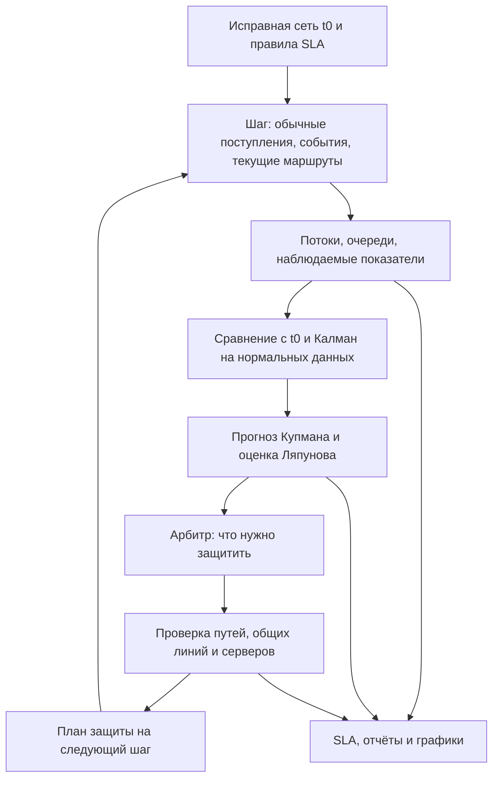

# Устройство и расчёты GNet9

Установка, команды и файлы результатов описаны в [README](../README.md).
Здесь — фактическое устройство модели и смысл решений.

## Как разобраться в проекте

GNet9 — воспроизводимая модель сети, а не средство управления работающим
оператором связи. Её главный вопрос: можно ли по уже доступным наблюдениям
заранее заметить ухудшение и сохранить качество важных услуг, если пропускная
способность линий и ресурсы серверов ограничены?

Начните с трёх представлений одного опыта:

1. **Сеть:** `network_logic.png` показывает, какие объекты действительно связаны.
2. **Время:** `charts/dynamics_overview.png` показывает, что наблюдали, когда
   предупреждали и что происходило с качеством.
3. **Доказательства:** `run_summary.md`, затем `step_log.csv` и
   `network_dynamics.json` позволяют проверить вывод по числам.

Для чтения этого документа удобно идти в таком порядке:

- [Сеть и уровни](#сеть-и-уровни), [один шаг](#один-шаг-расчёта) и
  [пример эксперимента](#пример-эксперимента-по-шагам).
- [Трафик и атаки](#обычный-трафик-и-атаки),
  [Калман](#фильтр-калмана), [Купман](#купман-прогноз-следующих-состояний),
  [Ляпунов](#ляпунов-растёт-ли-отклонение).
- [Кронекер](#векторы-кронекера-без-большой-матрицы),
  [защита](#карта-состояний-и-исполнение-защиты),
  [чтение результатов](#краткий-итог-и-чтение-результатов).
- [Карта файлов](#структура-проекта-и-карта-файлов),
  [план защиты](#как-показать-и-защитить-проект) и
  [вопросы с ответами](#вопросы-которые-стоит-уметь-объяснить).

Короткое объяснение всей цепочки: создаём исправную сеть, отдельно считаем
обычный поток и воздействие, измеряем состояние, отделяем шум, прогнозируем
его изменение, проверяем качество услуг и допустимые защитные действия.
Затем сохраняем результат, чтобы его можно было перепроверить.



План защиты, предупреждение и исполнение — разные записи. Схема показывает
обратную связь во времени; она не означает изменение эталона `t0`.

### Пример эксперимента по шагам

Для подробного разбора используйте команду из README:

```powershell
python main.py --attack-scenario predictive-demo --dynamics-steps 100 --step-seconds 2 --attack-start-step 50 --attack-interval-steps 10 --attack-seed 42
```

| Шаг / время | Что должно происходить по расписанию | Что проверять в результате |
|---|---|---|
| 0 / 0 с | Нагруженный исправный эталон | Состав, исходные маршруты, ненулевая нагрузка |
| 1–39 / 2–78 с | Участок до предвестников первой атаки | Пригодность наблюдений и фактически принятые переходы обучения |
| 40 / 80 с | Начинаются наблюдаемые предвестники | Обучение не принимает загрязнённые пары; признаки не сглаживаются |
| 40–49 / 80–98 с | Доступны признаки угрозы, самой атаки ещё нет | Прогноз и его окно, предупреждение после подтверждений |
| 50 / 100 с | Начинается первое воздействие | Наблюдённое событие, SLA по классам, выполненные действия |
| 60, 70… | Начала следующих событий через 10 шагов | Перекрытия событий, ресурсы и восстановление |
| 100 / 200 с | Конец заданного окна | Итог по событиям, худший SLA и ограничения опыта |

Это расписание воздействия, а не обещание конкретного результата прогноза
на каждом шаге. Вход в обучение определяется качеством наблюдения, а не
только номером шага. Время = номер шага × 2 с. Защита, предложенная сейчас,
может исполняться со следующего шага; поэтому соседние записи не обязаны
содержать одинаковое название действия.

В обычном `predictive-demo` без дополнительных параметров первая атака
начинается на шаге 70, предвестники — на 60, перед ними 59 переходов.
Если явно задать длину опыта, задайте также начало для воспроизведения
желаемого участка нормы. Нельзя объяснять результат словами «алгоритм знал
атаку на шаге 50»: это знает генератор сценария и последующая оценка,
а прогноз читает только наблюдения к текущему времени.

## Сеть и уровни

Сеть хранится как граф: вершины — объекты, рёбра — связи.
Абонент подключён к одному узлу доступа; выше него есть резервные пути.
Потоки проходят через сетевые устройства к физическому серверу услуги.
Абоненты, серверы и служебные вершины не пересылают чужой трафик.

| Уровень | Содержание |
|---|---|
| L0 | Шесть услуг и четыре сервера |
| L1 | 240 мобильных и 240 проводных абонентов |
| L2 | 12 маршрутизаторов, 6 коммутаторов, 6 радио- и 6 оптических узлов доступа |
| L3 | Среда передачи: ёмкость, затухание, помехи |
| L4 | Физические линии: длина, размещение, восстановление |
| L5 | Правила передачи и приоритеты обслуживания |
| L6 | Питание и запас энергии |
| L7 | Арбитр — модуль оценки состояния и выбора защиты |
| L8 | Географическое размещение |

L означает уровень. Питание, среда и размещение часто записаны как свойства
оборудования и линий. При расчёте эти свойства получают отдельные таблицы.
Услуги: голос, передача звука и видео, файлы, поиск сетевых адресов,
видеоконференция и прямая трансляция.

При малом числе обычных заявок требование к скорости ограничивается
реально предложенным объёмом: сеть не должна передавать отсутствующие данные.
Исходный предел SLA (соглашения о качестве услуги) и проверяемый спрос
сохраняются раздельно.
Пустой шаг проверяет доступность услуги.
Для оценки срока целого FTP-файла используется заданная средняя полезная
скорость, умноженная на наблюдаемую эффективность доставки и TCP-восстановления.
Один случайно малый объём за две секунды не означает уменьшение устойчивой
скорости всего файла. Например, 1 МиБ при ожидаемых 1048576 бит/с требует
8 с, при эффективности 50% — 16 с. Фактический goodput текущего шага
по-прежнему вычисляется из доставленных байтов. Время целого файла имеет
метку `assumed`: это условная оценка при сохранении текущей эффективности,
а не событие завершения реально смоделированной передачи.

SLA задаётся в `policies/l1_policies.d0sl`.
d0sl — текстовый язык правил. В нём указаны скорость, задержка, допустимые
потери и параметры конкретных услуг. Приоритеты: золотой (`gold`),
серебряный (`silver`), бронзовый (`bronze`).

## Один шаг расчёта

1. Получить текущие события и наблюдаемые признаки угрозы.
2. Получить обычные поступления по Пуассону, отдельно рассчитать атаки, маршруты и очередь.
3. Собрать показатели каждого уровня и сравнить их с `t0`.
4. Привести данные к единому масштабу, сгладить шум и построить прогноз Купмана.
5. Рассчитать изменение меры Ляпунова и карту состояний арбитра.
6. Подготовить защиту для следующего шага и записать результат.

Эталон `t0` и исходный граф не меняются. Рабочая модель прогноза обучается
на последовательных исправных состояниях. Обновление начинает действовать
со следующего шага: текущий прогноз и Ляпунов используют одну версию модели.
Переход, включающий признаки угрозы, атаку или возврат после неё, в обучение
не попадает. Расписание известно создателю событий, но не передаётся прогнозу.
Проверяется исходное качество до фильтра: потери, недоставка, невыполнение
SLA любого класса, изоляция или действующая перестройка исключают наблюдение
из нормы. Пониженное качество не становится нормой из-за малого значения риска.
Например, `gold_sla_compliance_ratio=0.9999` уже замораживает обучение.
В `koopman.nominal_training` раздельно записаны пригодность наблюдения
и принятие перехода; требуется пара из двух исправных наблюдений.

## Хаусдорф: насколько изменилось состояние

Тензор здесь — список чисел с именами и единицами. Списки собираются в
таблицу каждого уровня: строки — объекты, столбцы — показатели.
Для сравнения разные единицы приводятся к своим масштабам:

```text
отклонение = (текущее значение − значение t0) / масштаб показателя
```

Расстояние Хаусдорфа ищет для каждого объекта ближайшее состояние во второй
таблице, берёт самое большое расхождение и повторяет поиск в обратную сторону.
Имена объектов учитываются: совпадение чужого объекта не скрывает изменение
исходного. Итог `normalized_distance` приводится к шкале 0…1; наиболее
изменившиеся объекты записаны в `top_current_contributors`.

Есть три разные величины:

- Хаусдорф состояния — изменение нагрузки, потерь, питания и других показателей.
- Хаусдорф маршрута — изменение пути после защиты, измеренное через задержки
  между вершинами старого и нового пути.
- Близость угрозы — минимальная задержка от наблюдаемой цели угрозы до пути
  абонента золотого класса.

Для маршрута дополнительно сохраняются доля несовпадающих связей
(расстояние Жаккара) и отношение новой задержки к исходной.
Это пояснения изменения пути, а не три названия одного показателя.

## Купман: прогноз следующих состояний

Начальное правило строится по 64 небольшим воспроизводимым отклонениям
вокруг `t0`. Затем оно обновляется по исправному трафику:

```text
следующее отклонение ≈ K × текущее отклонение
```

K — небольшая матрица перехода. Она оценивается методом DMD (подбором
линейного правила по последовательности наблюдений). Тип угрозы определяется
по наблюдаемым признакам: росту нагрузки, числу источников, незавершённым
соединениям, ошибкам входа или изменению питания.

Используются последние 12 секунд наблюдений. Это отрезок прошлого для оценки
направления изменений. Прогноз строится до 20 секунд вперёд — это другой отрезок.
При шаге 2 секунды он содержит десять будущих состояний. Окно предупреждения
показывает начало и конец будущего отрезка, где расчёт пересекает порог.
Например, «84–100 с» при текущем времени 80 с означает предупреждение
на 4–20 секунд вперёд, а не знание точного времени начала атаки.

Раннее предупреждение требует распознанного вида, наблюдаемой цели,
превышения порога 0,30 и двух последовательных наблюдений в `predictive-demo`.
Оценка риска 0…1 задаёт силу сигнала; вероятность из неё не вычисляется.
Изменение обученного правила само по себе не считается новой угрозой.

## Ляпунов: растёт ли отклонение

Для устойчивой K находится матрица P:

```text
Kᵀ P K − P = −I
V = zᵀ P z / сумма диагональных элементов P
скорость изменения V = (V сейчас − V раньше) / длительность шага
```

z — отклонение состояния, I — единичная матрица, знак ᵀ меняет строки
и столбцы местами. V — численная мера отклонения, а не расход электроэнергии.
Положительная скорость усиливает необходимость защиты.
Её вклад равен `min(1, max(0, скорость) / 0.025)`.
Отрицательная скорость означает снижение меры отклонения.
Исходная скорость и величина V сохраняются рядом с приведённым вкладом.

## Векторы Кронекера без большой матрицы

Из таблицы каждого уровня вычисляются четыре числа: среднее отклонение,
среднеквадратичное отклонение, максимальное абсолютное отклонение и доля
изменившихся значений. Все исходные показатели участвуют в этих расчётах.

Ленивый оператор Кронекера (применение произведения без его хранения)
действует на вектор через `A × Z × Bᵀ`. A связывает уровни, B — четыре
показателя, Z — их таблица. Отношения общей услуги, объекта и линии
сохранены, но совместное хранение показателей не создаёт полной связности.
Направления вложения заданы явно:

```text
L0→L1; L1→L2; L2→L3,L4,L6,L8; L3→L4,L8;
L4→L8; L5→L2,L3; L6→L4.
```

Это ациклическая схема вложения. Отдельные связи обратной связи не
смешиваются с ней: L7 слушает SLA L0 и управляет L1/L2/L3/L5/L6,
включая питание, но не L4/L8. В матрице используется порядок
`A[получатель, источник]`. Коэффициент собственного переноса 0,93,
вклад зависимостей до 0,04 и матрица B — настройки стенда,
не результат обучения. `EDGE` остаётся самостоятельным каналом наблюдений.
Результат и ошибка доступны для каждого уровня в `tensor_matrix_koopman.per_level`.
Это дополнительная проверка согласованности состояний; основной прогноз
обучается отдельно. При обычном запуске `numpy.kron` не вызывается.
Тесты сравнивают ленивый способ с полной матрицей на ненулевых векторах.

Полная матрица Кронекера увеличивает размер, а не сжимает данные;
см. [описание NumPy](https://numpy.org/doc/stable/reference/generated/numpy.kron.html).


## Карта состояний и исполнение защиты

Границы хранятся в `arbitrator.TRIGGER_BANDS`. Нижняя граница включается
в следующий диапазон.

| Сигнал | Норма | Наблюдение | Защита | Срочная защита |
|---|---|---|---|---|
| Хаусдорф состояния | < 0,25 | 0,25–0,50 | 0,50–0,75 | ≥ 0,75 |
| Риск Купмана | < 0,25 | 0,25–0,35 | 0,35–0,70 | ≥ 0,70 |
| Приведённый рост Ляпунова | < 0,20 | 0,20–0,60 | 0,60–0,85 | ≥ 0,85 |

Общая сила решения — наибольшая из текущей оценки состояния, приведённого
риска прогноза и вклада Ляпунова. Текущая оценка учитывает запас качества
услуг, процессор, потери, запас устойчивости линий и наблюдаемое воздействие.
Приведённый риск равен `max(0, (риск − 0.20) / 0.80)`.
Каждый диапазон записывается в `arbitrator.trigger_card`.

| Общая сила | При подтверждённой угрозе |
|---|---|
| ≤ 0,20 | Наблюдать, маршруты сохранять |
| > 0,20 и < 0,50 | Подготовить и применить доступную защиту; сила фильтрации 90% от настройки типа |
| 0,50–0,75 | Защищать затронутые потоки; сила фильтрации 95% от настройки типа |
| ≥ 0,75 | Срочная защита; полная настроенная сила фильтрации |

Без подтверждённой угрозы превышение порога означает повторное наблюдение.
Шкалы — настройки проекта; они не означают, что каждое одинаковое число
должно приводить к одной мере для разных причин.

Перегрузка вызывает ограничение входящего потока и обход цели;
незавершённые соединения — защиту очереди соединений;
ошибки входа — меры для учётной записи; сбой питания — выбор пути и сервера
с независимым резервом. Изоляция требует подтверждённого источника.
Сравнение цены защиты и ожидаемого ущерба помогает выбрать вариант.
Фактические маршруты и серверы допускаются только после проверки ресурсов:
предел 80%, обслуживание сначала золотого класса. После события временные
меры снимаются. `attack_response_evaluation` показывает реакцию по событиям;
при перекрытии атак это наблюдения общей сети, а не выделенный ущерб одной атаки.
Полная изоляция источников прямой атаки прекращает её пакетный ущерб.
При отражённой атаке уже возвращающийся поток учитывается отдельно.
Остаточные пакеты текущих атак после действующей фильтрации формируются
один раз и участвуют и в допуске маршрутов, и в очередях. Фон занимает
общие линии до распределения золотого, серебряного и бронзового классов.
Например, 79 Мбит/с фона на линии 100 Мбит/с не позволяют принять ещё
1,1 Мбит/с при границе 80%. Неизвестный будущий трафик в этот расчёт не входит.
`maximum_admitted_route_utilization_percent` проверяет ресурсы принятых
новых маршрутов, а общий `maximum_projected_utilization_percent` честно
показывает и перегруженные атакой участки, даже когда новых маршрутов там нет.
Для резервного сервера отдельно проверяются CPU, память и сессии.
Одного `quarantine_sources` или названия этапа недостаточно: нужны источник
из текущего сетевого события либо сохранённая подтверждённая запись этого
события с совпадающим идентификатором. Неактивный план не показывает
выполненный карантин.

## Обычный трафик и атаки

Обычные заявки приходят по распределению Пуассона: среднее число за шаг
и его дисперсия равны интенсивности, умноженной на длительность шага.
Для TCP случайными являются сегменты данных; подтверждения вычисляются
из их числа. Для DNS (получения сетевого адреса по имени) случайно число
запросов, ответы учитываются отдельно.
Для голоса и видео случайно число пакетов; размер пакета сохраняется.
`t0` содержит ожидаемую ненулевую нагрузку. Число пакетов может быть нулевым
на последующих шагах. Начальное число генератора 42 вместе с абонентом
и шагом позволяет повторить обычный поток независимо от расписания атак.

В `predictive-demo` интервалы начала перегрузки имеют форму Вейбулла 1,5,
а медленных попыток входа — 0,7. Форма больше единицы означает рост
вероятности начала по мере ожидания; меньше единицы — её снижение.
Масштаб выбирается по среднему интервалу: `среднее / Gamma(1 + 1/форма)`;
Gamma — математическая гамма-функция. Это параметры сценария, а не
универсальный признак атаки. Смешанная серия имеет разные распределения
интервалов; события за концом окна отсекаются. В достаточно длинной серии
последние 11 шагов оставлены для окончания воздействия и восстановления
истории прогноза. Пользовательский фиксированный
интервал заменяет случайный выбор. Медленный подбор учитывает только события
входа, а не поток перегрузки; число ожидаемых попыток задаётся отдельно.

Обучение Купмана получает только переходы между исправными состояниями.
`normal_arrival_rate_pps` сохраняет обычные поступления, `attack_arrival_rate_pps`
— отдельный поток атак. Оба значения доступны в журнале шагов.

## Фильтр Калмана

Сначала выполняется нормировка: `(значение − t0) / масштаб`. Затем
фильтр Калмана (последовательная оценка состояния с учётом шума) сглаживает
обычные показатели. Для каждого показателя хранится своё значение и
дисперсия ошибки; полная матрица связей между ошибками не создаётся.
Ковариация (совместная неопределённость показателей) пока диагональная:
корреляции ошибок не оценены по измерениям оборудования.

```text
P до измерения = P прошлого шага + Q
усиление = P до измерения / (P до измерения + R)
оценка = прошлая оценка + усиление × (наблюдение − прошлая оценка)
P после измерения = (1 − усиление) × P до измерения
S = P до измерения + R = L Lᵀ, L = diag(sqrt(diag(S)))
усиление = (P до измерения / L) / L
```

Здесь P — дисперсия ошибки фильтра, Q=0,0001 — дисперсия изменения за шаг,
R=0,0025 — дисперсия шума нормированного измерения. Они безразмерные
настройки модели; матрица Ляпунова с таким же обозначением — другая величина.
Единые настройки задаются через `--kalman-process-variance` (Q ≥ 0) и
`--kalman-measurement-variance` (R > 0); NaN и бесконечность отклоняются
до запуска. Настройки сохраняются в `config` и передаются компактному,
локальному и тензорному каналам. Q относится к одному шагу: при смене
его длительности нужна повторная оценка, автоматического пересчёта нет.
Меньшее R увеличивает доверие измерению, меньшее Q усиливает сглаживание.
При Q=0 и нулевой начальной дисперсии оценка не меняется: этот режим
означает заданное неизменное состояние, а не автоматическую настройку шума.
Например, при начальном P=0 и Q=R=1 первое усиление равно 0,5.
Счётчики атак, потери и соблюдение SLA проходят без сглаживания.
Это относится также к показателям с суффиксами `.mean`, `.min`, `.max`,
ошибкам аутентификации и признакам питания: они не превращаются в шум
из-за того, что записаны внутри оси уровня вместо `OBS`.
Исходные данные, усиления, дисперсии и результат сохранены в
`koopman.kalman_filter`. При наблюдаемой угрозе или её предвестниках фильтр
сохраняет последнюю оценку исправной сети, а прогноз получает текущие значения
без сглаживания. После восстановления фильтр продолжает оценивать обычный шум;
ущерб атаки не остаётся в его памяти. Признак `applied_to_nominal_observation`
показывает, применялся ли фильтр на этом шаге. Он читает только уже поступившие
наблюдения. Обучение по-прежнему принимает лишь исправные переходы.
Такое же сглаживание отдельных нормированных значений применяется перед
тензорным каналом Купмана. Исходные снимки и `t0` остаются неизменными;
потери, сбросы пакетов, признаки атак и SLA проходят без сглаживания.
`tensor_matrix_koopman.input_kalman_filtered` показывает фактический режим.

### Холецкий, сигма-точки и локальные деформации

Разложение Холецкого представляет положительно определённую матрицу
ковариации как `P = L Lᵀ`. Для диагональной модели это корни дисперсий;
большая ковариационная матрица всей сети не создаётся. Никакого сброса
каждые десять шагов нет: большая невязка может означать угрозу.

В `koopman.kalman_filter.local_observation` записан отдельный локальный
разбор наблюдений `traffic.network_state`. Здесь 11 показателей вершины
и **9 показателей ребра**, включая `file_drop_fraction`; их имена и порядок
сохранены. Поэтому число сигма-точек (взвешенных состояний, передающих
среднее и ковариацию) равно 23 и 19, а для восьмимерного примера со схемы
оно было бы 17. Формула — `2n+1`, а не `3n`.

```text
x₀ = x; xᵢ = x + sqrt(n) L[:, i]; xᵢ₊ₙ = x − sqrt(n) L[:, i]
w₀ = 0; wᵢ = 1/(2n)
```

Используется квадратура моментов с `alpha=1, kappa=beta=0`; она не объявляется
нелинейным фильтром UKF. Входы — конечное среднее и симметричная положительно
определённая ковариация. Единицы ковариации — квадрат единиц среднего;
в расчёте все значения нормированы. Например, среднее 2, дисперсия 4 дают
точки `[2, 4, 0]` с весами `[0, 0.5, 0.5]`. Они точно восстанавливают оба момента.
Код категории `attack_profile` фиксируется во всех точках: он не является
непрерывным измерением. В наборе из 23 точек соответствующая пара совпадает
с центром, дисперсия категории равна нулю; независимых непрерывных осей здесь 10.
Неопределённая или несимметричная матрица отклоняется без скрытого исправления.
[Описание сигма-точек и переноса моментов](https://hankyang.seas.harvard.edu/OptimalControlEstimation/output-feedback.html)
поясняет общий метод.

Локальные маски Адамара выбирают по именам признаки перегрузки
`T1498.001`, `T1498.002`, `T1499.001`. Для каждого объекта вычисляется
махаланобисова длина (отклонение с учётом масштаба шума)
`d = ||L⁻¹ (M ⊙ (z − x_previous))||`, где `L Lᵀ = P_previous + Q + R`.
Например, одна нормированная невязка 1 при `P_previous=0` даёт
`d=1/sqrt(0.0026)`. Порог решения сюда не добавлен. Маски — инженерные
гипотезы стенда, а не утверждённые MITRE вероятностные модели.
В локальных осях нет ошибок входа и напряжения: `T1110.001` и `T0831`
по-прежнему обрабатываются основным каналом наблюдений.

Сигма-точки сохраняются максимум для пяти наиболее изменившихся объектов
каждого вида. Для сглаженных осей они описывают `P_posterior + R`, то есть
состояние с шумом следующего измерения; для осей без фильтра берётся R,
а дисперсия категории равна нулю. Категория атаки, показатели потерь, надёжности и SYN-ACK
проходят без сглаживания; при наблюдаемой угрозе вся локальная память заморожена.
Этот список помогает разбирать возможные места перестройки маршрутов,
но сам не разрешает изоляцию и не заменяет проверку ресурсов в `routing.py`.

`koopman_input_uncertainty.normalized_std_vector` содержит корни диагонали
`K_used diag(p) K_usedᵀ`: точный перенос неопределённости входа через текущее
линейное правило Купмана. Для сглаженных осей `p=P_posterior`, для остальных
`p=R`. Ревизия K сохранена рядом. Это **не полная ошибка прогноза**:
ошибка обучения K, будущий процессный шум и ошибка классификатора сюда
не входят. Значения Q/R — явные допущения модели, а не подтверждённая
точность датчиков; внешняя калибровка и проверка покрытия остаются необходимыми.
[Исходная работа Калмана](https://people.duke.edu/~hpgavin/SystemID/References/Kalman-JBE-1960.pdf)
описывает последовательную оценку по состоянию и ошибке измерения.

## Очереди Геленбе, TCP и UDP

Очередь Геленбе (очередь с обычными и уничтожающими заявками) содержит
не более 128 пакетов. Обычные заявки добавляют работу, отрицательная заявка
удаляет один пакет из начала непустой очереди; при пустой очереди она
не действует. Это [модель положительных и отрицательных заявок](https://www.cambridge.org/core/journals/journal-of-applied-probability/article/abs/productform-queueing-networks-with-negative-and-positive-customers/E1DE9FDA1EFB99064DD910039B0847EE).

Для постоянных интенсивностей текущего шага λ — поступление, μ — обслуживание,
ν — уничтожение, всё в пакетах/с. Вероятность n пакетов пропорциональна
`(λ/(μ+ν))**n`. Расчёт сохраняет баланс: поступление равно обслуживанию,
уничтожению и переполнению вместе. При вместимости 1 и λ=2, μ=ν=1:
обслуживание и уничтожение по 0,5 пакета/с, переполнение 1 пакет/с,
среднее пребывание 500 мс, дисперсия 250000 мс².
Для вместимости 2 при тех же λ, μ, ν получается 750 мс и 437500 мс².
Условное распределение допущенных заявок нормируется отдельно, чтобы
при сильной перегрузке округление вероятности заполнения к 1 не обращало
задержку в ноль.

DoS добавляет положительную конкурирующую нагрузку `attack_arrival_rate_pps`.
Отрицательные заявки ν — эквивалент уничтожения по потерям, а не другое
название интенсивности любой атаки. Стационарная очередь описывает этот
механизм при постоянных интенсивностях шага; аутентификация, изменение
маршрутов и питание требуют своих моделей. Универсальность для любой DoS
и точный переходный процесс этой формулой не доказываются.

В потоке μ задаётся резервом SLA с поправкой на заголовки и подтверждения;
оно не подстраивается под случайное число поступивших пакетов. Поток
перегрузки делится между затронутыми потоками. Интенсивность уничтожения
оценивается по уже рассчитанным потерям: `ν = μ × доля потерь / (1 − доля)`.
Для полной потери знаменатель ограничен 0,001. Это оценка механизма ущерба;
расчётные вероятности и наблюдаемые счётчики записываются раздельно.
Задержка очереди и TCP-восстановления дополняют суммарную задержку один раз:
`добавка = max(0, очередь + восстановление − уже учтённая задержка атаки)`.
Изолированные потоки не забирают долю конкурирующей нагрузки.
Разброс задержки
очереди используется также при оценке требования SLA к разбросу, с отметкой
о расчётном происхождении.

TCP тратит время на восстановление после потерь; полезная скорость и
задержка доставки учитывают это время. UDP повторную передачу не выполняет.
Пакеты повторно не списываются. В `transport_queue` сохранены интенсивности,
обслуживание, уничтожение, переполнение, средняя очередь и задержка.
[Правила восстановления TCP](https://www.rfc-editor.org/rfc/rfc5681)
объясняют различие; параметры оценки задаются в коде.

## Показатели графа и зависимость уровней

`traffic.network_state` — граф текущего шага с именованными показателями.
Порядок старых таблиц уровней сохранён. По умолчанию все значения хранятся
компактными строками: `node_ids` и `vertex_vectors`, `edge_ids` и `edge_vectors`;
имена и единицы указаны один раз. При `--packet-detail flows` сохраняются
именованные записи с подробностями очереди. Новая запись вершины содержит:

| Поле | Значение и единица |
|---|---|
| `normal_arrival_rate_pps` | Обычные поступления, пакетов/с |
| `negative_arrival_rate_pps` | Оценка уничтожающих заявок, пакетов/с |
| `service_rate_pps` | Скорость обслуживания, пакетов/с |
| `utilization_ratio` | Вероятность занятости, 0…1 |
| `destroyed_packet_fraction` | Наблюдаемая доля потерянных обычных пакетов |
| `mean_queue_packets` | Среднее число ожидающих пакетов |
| `mean_delay_ms` | Среднее пребывание в очереди, мс |
| `delay_variance_ms2` | Дисперсия задержки, мс²; её корень — разброс в мс |
| `attack_profile` | Числовой код типа; расшифровка в `attack_profiles` |
| `cpu_load_percent` | Загрузка процессора, %; для устройств оценка по занятости |
| `buffer_memory_mib` | Память ожидающих пакетов, МиБ (1024² байт) |

У линии девять полей: `capacity_mbps` — предел скорости;
`propagation_delay_ms` — задержка распространения; `jitter_ms` — заданный
разброс задержки; `loss_probability` — потери; `reliability_ratio` — надёжность;
`utilization_ratio` — доля занятой полосы; `speed_mbps` — скорость потока;
`syn_ack_fraction` — доля ответов SYN-ACK при установке TCP;
`file_drop_fraction` — доля потерянных пакетов передачи файлов.
Скорости в Мбит/с, задержки в мс, доли 0…1, загрузка может превышать 1.

Источник каждого спорного показателя обозначен рядом: без заданного разброса
линии используется ноль с отметкой `not_configured`; без отдельной надёжности
сохраняется оценка по вероятности доставки. Сквозные потери учитываются один
раз у абонента и на его крайней линии (у атакующего потока — у получателя).
Это учётная модель, а не доказанное место отбрасывания.
Например, 10 потерь на пути из двух линий остаются 10, а не дают 20.
`exposed_end_to_end_flow_drops` отдельно показывает подверженность маршрута
сквозной потере и не суммируется как новый ущерб. Компактный экспорт сохраняет
`node_observed_dropped_packets`, `edge_observed_flow_drops` и
`node_attack_arrival_rates_pps`; поля `metric_origins` поясняют происхождение.
CPU и буфер — оценки по очереди/среднему размеру пакета, а не измеренная RAM.
Целые
недоставленные файлы из потерь пакетов не выводятся.

`hypernetwork` хранит гиперсеть (связи, объединяющие сразу несколько объектов
и уровней) как список отношений. Участник — существующий объект и его уровень.
Числовое вложение этих отношений задаёт связи A ленивого оператора Кронекера.
Новых физических объектов и команд оборудованию это не создаёт.

`sla_resilience` показывает устойчивость качества на пройденных шагах:
долю потоков, выполнивших SLA, с весами 3/2/1 для золотого, серебряного и
бронзового классов, её минимум и среднее за время. Веса — явная настройка.
Это итог наблюдений, не обещание оптимальности при любой будущей атаке.

## Карты и графики

Схема сети и карта потоков используют одни координаты и один способ рисования.
Показываются реальные связи графа; условные кольца и зоны питания удалены.
Точки абонентов остаются видимыми, назначения уровней вынесены на отдельную
схему. Карта адресов показывает устройства и диапазоны шести абонентских
подсетей; полные 480 записей сохраняются в `ip_address_plan.json`.

Обзор динамики разделяет предупреждение, оценку состояния, выполнение SLA,
применённую защиту, обычный трафик и поток атак. Выполнение SLA — доля потоков,
прошедших проверку качества; оно отличается от доступности маршрута. Если
данных нет, линия не рисуется. Сглаженный ряд Калмана показан лишь там, где
фильтр действительно применялся. Предложенный и допущенный потоки атак
сравниваются в Мбит/с. Попытки входа и питание учитываются как события.

Нагрузка линий вычисляется по скорости каждого шага, поэтому разная
длительность наблюдений не искажает пик. Компактный сохранённый отчёт
содержит все необходимые данные для повторного построения графика.
Предел допуска маршрутов берётся из расчёта защиты, без второго порога
в визуализации. Отдельный график показывает пик каждой линии и нагрузку
сети во времени. Оформление находится в `plot_style.py`, размещение узлов —
в `network_layout.py`, тексты карточек — в `flow_details.py`. Эти модули
не меняют расчёты модели.

Число шагов начального участка по плану отделено от числа принятых
переходов обучения. Предупреждения показываются рядом с временными
интервалами наблюдённых событий; отсутствие данных оставляет разрыв.
Нагрузка линий и процессор/память/сессии серверов имеют отдельные подписи,
поэтому один общий максимум не выдаётся за загрузку физической линии.

Окно воспроизводит сохранённую последовательность после расчёта модели.
Карточки разделяют наблюдаемое событие, прогноз и его окно, качество услуг,
исполненные действия и состояние обучения/Калмана. Предложение арбитра
отличается от фактических действий текущего шага. Наведение сначала ищет
текущие показатели в `traffic.network_state`; если они отсутствуют,
эталонные свойства явно помечаются как исходные. Стрелки, Home/End и
пробел управляют показом. Анимированные точки — ограниченная выборка
потоков, а не отображение каждого пакета симуляции.

## Краткий итог и чтение результатов

`run_summary.md` — результат конкретного запуска, а не ещё одно руководство.
В нём показаны число реально принятых переходов, предупреждения, худшее
выполнение SLA каждого класса с числителем/знаменателем и шагом, ресурсы
принятых маршрутов и список наблюдённых событий. `run_summary.json`
содержит те же данные, параметры запуска и версии Python/библиотек.
Это небольшая точка входа перед чтением подробного `network_dynamics.json`.

Большой JSON сохраняет прежние ключи и добавляет в начало
`export_metadata.schema_version=2` и `result_summary`. Отдельный краткий
отчёт имеет `schema_version=1`. Числа JSON конечны: NaN/Infinity не
записываются. Отсутствующие оценки обозначаются `null`. Без наблюдённых
начал атак `prediction.evaluated=false`; точность и упреждение в кратком
отчёте равны `null`, а не ошибочно трактуются как нулевой успех прогноза.

SLA относится к проверяемым требованиям. Полнота моделирования требований
сохранена отдельно в `assessment_coverage_ratio_at_worst_step` и исходных
оценках услуг. Подтверждённые источники атак исключены из учёта SLA;
остальные изолированные потоки считаются отказами. Максимумы действий
за шаг не являются числом уникальных действий за весь прогон.

`step_log.csv` сохраняет прежние колонки и добавляет применение фильтра,
принятие перехода, окно предупреждения, SLA трёх классов, идентификаторы
событий/целей и исполненные действия. Недостающая телеметрия оставляет
пустую ячейку. `algorithm_dialogue` поясняет входной фильтр, прогноз,
предложение арбитра и фактическое исполнение раздельно.

## Согласованные границы проекта

Итоговые решения имеют приоритет над ранними предложениями:

| Сохранено в модели | Отложено или заменено |
|---|---|
| 480 абонентов, 30 сетевых устройств, 4 сервера, 6 услуг | Ранние меньшие составы |
| Одна последняя линия доступа у абонента, резервирование выше | Дополнительные линии абонентов золотого класса |
| Пуассон для нормы; Вейбулл 1,5/0,7 по типам событий | Восемь обязательных атак и растягивание интервалов под окно |
| Неизменяемый нагруженный `t0`, обучение по исправным парам | Эталон без трафика и задержек, обучение на каждом состоянии |
| Ленивый Кронекер и ориентированное вложение | Большая полная матрица и предположение, что само произведение сжимает данные |
| Маршрутный слой в памяти, Ляпунов и наблюдения трафика | SRv6 и отправка команд оборудованию |
| Три основных документа | Дублирующие руководства и словари |

Сигма-точки и Калман используют заданную модель ошибки; тензорный канал
остаётся вспомогательным. Независимая внешняя точность и устойчивость
физической сети этими результатами не подтверждены. Улучшение оформления
не меняет этих границ и не скрывает ухудшение SLA младшего класса.

## Структура проекта и карта файлов

Начальная точка чтения кода — `main.py`, затем `dynamics.py`.
Первый собирает эксперимент и сохраняет файлы, второй связывает расчёты
в последовательность шагов. Остальные модули удобно читать по вопросу,
на который нужно ответить, а не в алфавитном порядке.

### Корень репозитория

| Путь | Назначение | Когда открывать |
|---|---|---|
| `main.py` | Разбор команд, создание модели, запуск, экспорт, открытие окон | Нужно изменить режим запуска или понять происхождение файла результата |
| `requirements.txt` | Зависимости Python | Установка или воспроизведение окружения |
| `pyproject.toml` | Настройки поиска и запуска pytest | Изменение организации тестов; это не отдельный режим модели |
| `policies/l1_policies.d0sl` | Требования к шести услугам по классам обслуживания | Вопрос о нормативе скорости, задержки, потерь и особенностях услуги |
| `src/gnet9/` | Вся логика модели | Нужна конкретная формула или правило |
| `tests/` | Проверки отдельных расчётов и целых сценариев | Нужно подтвердить утверждение проверочным примером |
| `tools/check.py` | Команды `doctor`, `quick`, `full`, `smoke` и журналы | Проверка перед коммитом и после доработки |
| `.github/workflows/ci.yml` | Автоматические полные и пробные проверки на GitHub | Вопрос о проверке на Windows/Linux и разных Python |
| `.github/ISSUE_TEMPLATE/` | Формы описания ошибок и предложений | Нужно передать воспроизводимую проблему |
| `.gitignore` | Исключение окружения, результатов и временных файлов | Проверка того, что не попадёт в Git |
| `.editorconfig` | Кодировка UTF-8, отступы и окончания строк | Единообразное редактирование в разных редакторах |
| `LICENSE` | Условия лицензии MIT | Условия использования и распространения кода |
| `README.md` | Установка, команды, результаты, Git | Быстро запустить или повторить опыт |
| `doc/full_project_explanation_ru.md` | Этот документ: устройство и обоснования | Подготовка к защите и изменение расчётов |
| `AGENTS.md` | Правила разработки и неизменные условия | Перед любыми изменениями проекта |
| `output/` | Созданные данные, изображения и журналы | Анализ конкретного запуска; не исходный код |
| `.venv/` | Локальный Python с библиотеками | Запуск и установка; не переносится коммитом |

NumPy выполняет матричные вычисления; NetworkX хранит граф и ищет пути;
Matplotlib строит изображения и окно; pytest запускает тесты. Отдельная
СУБД, веб-сервер и подключение к сетевому контроллеру для запуска не нужны.

### Состав сети, эталон и правила услуг

Далее все имена файлов относятся к `src/gnet9/`.

| Файл | Какая логика находится внутри |
|---|---|
| `models.py` | Структуры данных: сеть, тензор с именами и единицами, серверы, услуги, профили и срезы |
| `constants.py` | Размеры стандартной сети, роли устройств, постоянные имена, подписи и цвета |
| `topology_builder.py` | Сборка исходного графа, подключение абонентов, размещение услуг и серверов |
| `baseline.py` | Исходные показатели уровней L0–L8 и транспортных связей для исправного `t0` |
| `tensors.py` | Описания осей и создание тензоров уровней и линий |
| `addressing.py` | Сетевые адреса и идентификаторы объектов внутри модели |
| `service_catalog.py` | Каталог услуг и кодеков, свойства серверов, оценка требований к качеству |
| `l2_equipment.py` | Профили оборудования, ссылки на характеристики и расчётные допущения |
| `l1_d0sl.py` | Чтение декларативных правил услуг, приведение к типам, параметры очередей и мониторинга |
| `standards_audit.py` | Происхождение требований и характеристик, различие источников, оценок и допущений |

Не меняйте количество абонентов ради ускорения проверки: это изменяет задачу.
Изменение цвета в `constants.py` не влияет на качество услуги, а изменение
пропускной способности влияет. Паспортная мощность блока питания не равна
расходу устройства; происхождение таких значений хранится отдельно.

### Трафик, воздействие, очередь и измерение

| Файл | Какая логика находится внутри |
|---|---|
| `normal_traffic.py` | Поступления обычного трафика по Пуассону, отдельная воспроизводимость по объекту и шагу |
| `attacks.py` | Типы и профили событий, фиксированное и вероятностное расписание, предвестники, воздействие, состояния питания и оценка качества при событиях |
| `packet_simulator.py` | Потоки услуг TCP/UDP, объёмы и счётчики, применение текущих путей и защиты, итоги и показательные пакетные записи |
| `gelenbe.py` | Численные характеристики конечной очереди с обычными и уничтожающими заявками |
| `transport_queue.py` | Применение очереди к потоку, различия TCP/UDP, полезная доставка и восстановление TCP |
| `runtime_metrics.py` | 11 показателей вершины и 9 показателей ребра, единицы, текущие таблицы, однократное распределение потерь |
| `routing.py` | Допустимые промежуточные роли и базовый поиск маршрутов |
| `remapping.py` | Планирование обходов и смены сервера, резервирование общих ресурсов, приоритет классов и изоляция подтверждённых источников |

Поток — запись о передаче конкретной услуги, пакеты — единицы её объёма,
очередь — модель ожидания обслуживания. Эти три понятия связаны, но одна
запись потока не равна одному пакету. Пакетная симуляция выполняется в памяти.
Сохранённые примеры TCP/UDP не являются отправленными сетевыми пакетами.

### Состояние, прогноз и решение

| Файл | Какая логика находится внутри |
|---|---|
| `dynamics.py` | Конфигурация и цикл времени, снимки, наложение текущих наблюдений на рабочие состояния, передача плана на следующий шаг, последующая оценка прогноза |
| `metrics.py` | Сравнение с эталоном, расстояния Хаусдорфа состояния и пути, вспомогательные расстояния |
| `kalman.py` | Нормированное сглаживание, проверка Q/R, разложение Холецкого и генерация сигма-точек |
| `local_observation.py` | Локальные наблюдения 11/9, маски признаков, махаланобисовы отклонения и диагностические точки изменившихся объектов |
| `koopman.py` | Компактное линейное правило, начальные синтетические пары, обновления на норме, наблюдаемая динамика угроз, прогноз, Ляпунов и неопределённость входа |
| `tensor_matrix.py` | Таблицы с именованными осями, сводные признаки уровней, ленивое применение Кронекера и вспомогательный тензорный канал |
| `hypernetwork.py` | Соответствие объектов уровням и направленные зависимости вложения; отдельно — связи управления |
| `arbitrator.py` | Карта состояний, согласованные пороги реакции, важность узлов и игровая оценка вариантов защиты |
| `sdn_controller.py` | Перевод выбранных решений в описания действий внутри симуляции; команд оборудованию нет |
| `telemetry_validation.py` | Чтение внешнего ряда риска, выбор порога на ранней части и независимая хронологическая проверка на поздней |

Важное разделение: `koopman.py` отвечает «что может произойти»,
`arbitrator.py` — «какой уровень реакции нужен», `remapping.py` —
«какое действие физически допустимо в модели», а `dynamics.py` связывает
их во времени. Один высокий риск не означает, что любой новый путь разрешён.

### Отчёты и изображения

| Файл | Какая логика находится внутри |
|---|---|
| `run_report.py` | Компактные `run_summary.md/json` из уже рассчитанных результатов |
| `decision_dialogue.py` | Пояснение измерения, фильтра, прогноза, предложения и исполнения |
| `visualizer.py` | Статическая схема сети и схема уровней |
| `flow_visualizer.py` | Карты потоков и окно воспроизведения по шагам |
| `flow_details.py` | Карточки, подписи и показатели при наведении, различие текущих и исходных значений |
| `network_layout.py` | Общие координаты для карт, без изменения связности сети |
| `dynamics_charts.py` | Два итоговых графика: динамика и ограничивающие ресурсы |
| `plot_style.py` | Единое оформление и сохранение изображений |
| `address_visualizer.py` | Карта адресов и экспорт адресного плана |
| `debug_visualizer.py` | Журнал вызовов, схема выполнения и диагностическое окно |
| `__init__.py` | Обозначение пакета Python |

Графики и текст читают результаты, а не вводят собственные пороги защиты.
Если меняется подпись оси, формула остаётся в расчётном модуле; если
меняется формула, проверять нужно также её потребителей и единицы в отчёте.

### Где искать проверку утверждения

| Утверждение | Основные файлы в `tests/` |
|---|---|
| Состав, допустимые пути, адреса, неизменность эталона | `test_topology.py`, `test_model_controls.py` |
| Пуассон, независимость обычного трафика, чистые пары обучения | `test_normal_learning.py` |
| Калман, исключение угроз и потерь из сглаживания | `test_kalman_contract.py` |
| Холецкий, моменты сигма-точек, локальные 11/9 и маски | `test_cholesky_observation.py` |
| Направления уровней и ленивый Кронекер | `test_hypernetwork_contract.py`, `test_tensor_matrix_arbitration.py` |
| События, причинный прогноз и ограничение ресурсов защиты | `test_attacks.py`, `test_predictive_remapping.py`, `test_remapping_confirmation.py` |
| Очередь, счётчики потерь и отсутствие двойного ущерба | `test_runtime_accounting.py`, `test_voice_traffic.py` |
| Качество услуг и условное время FTP-файла | `test_services.py`, `test_ftp_forecast.py` |
| Внешний порог и независимая поздняя часть ряда | `test_telemetry_validation.py` |
| Форматы результатов и краткий отчёт | `test_main_exports.py`, `test_run_report.py` |
| Графики, карты, карточки и диагностика | `test_chart_presentation.py`, `test_flow_presentation.py`, `test_visualization.py`, `test_debug_visualizer.py` |
| Работа средства проверки | `test_check_tool.py` |

Тест — проверка определённого свойства на заданных входах. Число пройденных
тестов само по себе не измеряет точность обнаружения на новой сети.

## Как показать и защитить проект

### Последовательность объяснения

1. **Задача.** Поддержка SLA при ограниченных ресурсах и изменяющемся состоянии.
   Покажите три класса обслуживания и объясните, почему один общий средний
   показатель может скрыть отказ младшему классу.
2. **Объект.** Сеть 480/30/4/6, девять уровней, одна последняя линия доступа
   абонента. Покажите реальные связи и места возможного обхода.
3. **Эталон.** `t0` исправен, нагружен и неизменен. Обычный трафик случаен;
   исправность не означает одинаковые числа на каждом шаге.
4. **Наблюдение.** Назовите 11/9 показателей, единицы и разделение нормального
   потока, положительной нагрузки атаки и уничтожающих заявок.
5. **Фильтр.** Масштабирование, Калман на норме, Q/R, Холецкий и локальные
   сигма-точки. Покажите, почему признаки атаки не должны исчезнуть в фильтре.
6. **Прогноз.** Обучаемое линейное правило, последние наблюдения, окно до 20 с,
   подтверждение предупреждения. Покажите момент сигнала до начала события.
7. **Решение.** Хаусдорф, Ляпунов, арбитр; затем допустимость пути и сервера.
   Объясните исполнение плана на следующем шаге.
8. **Результат.** Предупреждения, пропуски, ложные эпизоды, фактическое
   упреждение, худший SLA каждого класса и ресурсы принятого пути.
9. **Достоверность.** Тесты, несколько случайных рядов, повторяемость и
   ограничения: синтетические данные, заданные шумы и модель воздействия.

### Что подготовить перед показом

Выполните исправный опыт и несколько `predictive-demo` с разными
`--attack-seed`. Сохраните каждую папку результатов отдельно, как показано
в README. Не выбирайте только удобный график: сравните исходы всех рядов.
Для одного объясняемого опыта используйте явные длину, шаг и начало атак.
Подготовьте карту сети, два графика, `run_summary.md`, несколько строк CSV
вокруг предупреждения и начала события. Окно можно показать дополнительно:
это воспроизведение расчёта, оно не является источником измерений.

Начните с итогового отчёта, затем объясните конкретный момент на графике,
затем подтвердите его строкой CSV или снимком JSON. Не открывайте сначала
весь большой JSON: он предназначен для подробной проверки.

### Как разбирать один спорный эпизод

Зафиксируйте номер шага и время. В `snapshots` большого JSON найдите
соответствующий снимок, затем читайте по цепочке:

| Вопрос | Где искать |
|---|---|
| Что наблюдалось? | Текущий `traffic`, `traffic.network_state`, наблюдаемые события и показатели |
| Сглаживались ли данные? | `koopman.kalman_filter`, его признак применения; для тензорного канала — `tensor_matrix_koopman.input_kalman_filtered` |
| Принята ли пара в обучение? | `koopman.nominal_training.transition_accepted` и причина отказа |
| Что прогнозировали? | Раздел `koopman`, предупреждение и будущее окно; кратко — строка `step_log.csv` |
| Как объяснено решение? | `algorithm_dialogue.md` и карта состояний арбитра в снимке |
| Что реально исполнили? | `attacks.routing.actions` и количественные итоги текущей защиты |
| Сохранилось ли качество? | SLA по классам, исходные оценки потоков и полнота проверенных требований |
| Хватило ли ресурсов? | Показатели принятого маршрута, общих линий и резервного сервера; второй график |

Для сравнения прочитайте также предыдущий и следующий снимки. Метка события
в генераторе нужна последующей оценке, но сама по себе не доказывает, что
прогноз распознал его без подсказки. Проверки независимости от будущего
расписания подтверждают именно это разделение.

## Вопросы, которые стоит уметь объяснить

### Зачем нужны одновременно граф, тензоры и гиперсеть?

Граф отвечает «кто с кем соединён». Тензоры с именованными осями отвечают
«какие у объекта свойства и как они изменились». Гиперсетевое вложение
связывает описания разных уровней одной сети. Это разные представления,
они не добавляют новые физические линии. Проверка пути всегда использует
настоящие связи графа.

### Где в модели нормальный трафик, а где атака?

Норма — отдельные поступления по Пуассону. Для интенсивности λ пакетов/с
и шага Δt секунд среднее число поступлений равно λΔt пакетов. При λ=10
и Δt=2 среднее равно 20; конкретное число случайно. Атаки создаются
отдельно. Изменение будущего расписания не меняет нормальный ряд.
Начальное число `--attack-seed` управляет событиями, не генератором нормы.

### Что означает форма Вейбулла больше или меньше единицы?

Это форма распределения времени ожидания начала, а не величина ущерба.
В стенде для перегрузки берётся 1,5: условная интенсивность начала растёт
с ожиданием. Для медленных попыток входа — 0,7: она убывает. Сам по себе
выбор формы не доказывает тип любой реальной атаки. При фиксированном
`--attack-interval-steps` время начала задаётся этим интервалом.

### Чем положительная атака отличается от отрицательной заявки Геленбе?

Положительная нагрузка атаки добавляет пакеты и занимает обслуживание.
Отрицательная заявка — модель удаления обычной заявки из очереди.
Поэтому `negative_arrival_rate_pps` нельзя называть всем входящим атакующим
трафиком. Положительный поток сохраняется отдельно как
`attack_arrival_rate_pps`. Геленбе описывает выбранный механизм очереди;
этого недостаточно, чтобы объявить универсальное моделирование любого DoS.

### Что именно делает фильтр Калмана?

Он сочетает предыдущую оценку и новое нормированное наблюдение с весом,
зависящим от неопределённости. Нормировка приводит единицы к сравнимому
масштабу; Калман после этого уменьшает обычные случайные колебания.
Это две разные операции. При потере качества или признаках угрозы текущие
значения передаются без сглаживания, а память нормы не обучается на ущербе.

### Что такое Q, R и P и откуда они взялись?

Q — допущение об изменении состояния за шаг, R — допущение о шуме измерения,
P — текущая неопределённость оценки. Здесь Q/R заданы настройками, а не
получены с реальных датчиков. Связи ошибок между осями не обучены,
ковариация диагональная. При смене длительности шага Q автоматически
не пересчитывается. Матрица P в формуле Ляпунова — другая матрица.

### Почему Холецкий не делает измерение точным автоматически?

Он раскладывает уже заданную ковариацию на `L Lᵀ` и позволяет устойчиво
работать с неопределённостью. Если сама ковариация неверна, разложение
не исправит исходное допущение. Получаемая область неопределённости —
эллипсоид в пространстве нормированных показателей; при одинаковых
дисперсиях и отсутствии корреляций это сфера. Это не гарантия SLA.

### Почему 23 точки для вершины и 19 для ребра, а не 33 и 24?

Применяется набор `2n+1`: центр, плюс и минус вдоль каждой оси.
Для 11 осей получается 23; для текущих 9 осей ребра — 19.
В ранней схеме для 8 было бы 17. Категория атаки не является непрерывной
величиной: соответствующая пара совпадает с центром. Точки восстанавливают
заданные моменты ошибки; они не добавляют независимые датчики.
Полный нелинейный UKF здесь не реализован.

### Что такое маска Адамара и зачем махаланобисово расстояние?

Маска выбирает поэлементным умножением только признаки рассматриваемого
воздействия. Махаланобисово расстояние сопоставляет невязку с масштабом
шума: одинаковое отклонение значимее у более точного измерения. Маска —
объяснимая гипотеза стенда, а не обученный вероятностный классификатор MITRE.
Локальная оценка помогает найти изменившийся объект, но не разрешает
изоляцию без подтверждения и не отменяет проверку ресурсов.

### Что на самом деле прогнозирует Купман?

Основной канал — конечномерная линейная аппроксимация перехода компактного
вектора наблюдений. Она начинается с 64 синтетических отклонений вокруг
эталона и обновляется на исправных парах. Дополнительно используются
наблюдаемые тренды и признаки угрозы. Это не точное знание будущих пакетов,
не универсальная нелинейная модель и не обучение распознаванию всех атак
по размеченному внешнему набору.

### Как исключено знание будущей атаки?

Генератор знает расписание, прогноз получает только текущие и прошлые
наблюдения. Скрытый идентификатор события, его будущий старт и будущий
исход защиты не являются входами прогноза. После опыта оценщик сравнивает
сохранённые предупреждения с реально начавшимися событиями. Знание будущего
допустимо у такого оценщика, но не у работающего прогнозатора.

### Как связаны горизонт, окно и упреждение?

Горизонт — насколько вперёд строится расчёт, обычно до 20 с.
Окно — будущий отрезок, где ожидается превышение порога.
Фактическое упреждение — время от предупреждения до наблюдённого начала.
Требуемое упреждение — критерий успеха, по умолчанию 10 с для
`predictive-demo`. Это четыре разные вещи. При шаге 2 с прогноз дискретен;
он не обещает точность до миллисекунды.

### Что означает риск 0,8?

Сильный сигнал по внутренней шкале 0…1. Он не означает автоматически
80% вероятности атаки. Для вероятностной интерпретации потребовались бы
отдельная калибровка и проверка на независимых данных. Порог внешнего
ряда проверяется отдельно; эта проверка не превращает всю модель в
универсальную систему вероятностного распознавания.

### Зачем отдельный оператор Кронекера?

Он переносит отклонения между связанными уровнями и четырьмя сводными
признаками каждого уровня. Факторизация позволяет выполнить действие
без огромной общей матрицы. Здесь коэффициенты заданы, канал вспомогательный;
его нельзя представлять как обученный прогноз всего глобального тензора.
Математическая эквивалентность ленивого вычисления проверяется отдельно.

### Что доказывает функция Ляпунова?

Она измеряет отклонение в метрике выбранной линейной модели. Уравнение
для устойчивой K объясняет поведение этой модели, а положительная текущая
скорость V указывает на рост отклонения. Это не доказательство устойчивости
любого реального оборудования при произвольной атаке. Соседние состояния
оцениваются одной версией P, чтобы смена модели не создавала ложный скачок.

### Почему одного Хаусдорфа недостаточно для защиты?

Он показывает изменение состояния, но не всегда объясняет причину и
допустимое действие. Нужны наблюдаемые признаки, качество услуг, прогноз,
важность затронутых путей и проверка свободных ресурсов. Расстояние состояния,
изменение пути и задержка до цели угрозы не заменяют друг друга.

### Что даёт теория игр и означает ли она оптимальную защиту?

В `arbitrator.py` сравнивается небольшая конечная таблица цены защиты и
оценённого ущерба. Чистое равновесие Нэша показывается, если найдено
взаимное лучшее решение. Иначе явно выбирается maximin — лучший результат
в худшем из рассмотренных случаев. Коэффициенты таблицы заданы в модели.
Это объяснимая помощь арбитру, не доказательство глобального оптимума
и не утверждение о поведении реального нарушителя.

### Как проверяется перемаршрутизация?

Маршрут проходит через разрешённые сетевые устройства. Защита обслуживает
Gold, затем Silver и Bronze. При допуске учитываются общие линии, уже
размещённые потоки, остаточная нагрузка атаки и ресурсы резервного сервера:
процессор, память и сессии. Предельная загрузка нового размещения — 80%.
Короткий путь сам по себе не гарантирует допустимость. Подтверждение
источника обязательно для изоляции.

### Почему общая нагрузка может быть выше 80%?

80% — предел допуска новых маршрутов с резервированием ресурсов.
Это не ограничитель интенсивности самой атаки. Текущая атакуемая линия
может быть перегружена; график показывает это отдельно от максимума
ресурсов принятого защитного размещения. Нельзя скрывать перегрузку
обрезанием оси или смешивать её с допустимостью нового пути.

### Может ли защита всегда сохранить SLA всем?

Нет: ресурсы конечны, приоритеты различаются, последняя линия доступа
абонента одна. Обход выше по сети не восстанавливает оборванную единственную
линию. Gold может сохранять качество, когда Bronze уже теряет его.
Отчёт обязан показать это по классам и отдельным требованиям, а не только
по общей взвешенной доле.

### Как различать вероятность потери и число потерянных пакетов?

Вероятность очереди — расчётная характеристика. Наблюдённый счётчик —
сколько пакетов текущего потока не доставлено в симуляции. Потеря пакетов
не равна потере целых FTP-файлов. Один и тот же недоставленный пакет
не должен повторно считаться ущербом на каждом участке пути.

### Чем джиттер отличается от дисперсии задержки?

Дисперсия измеряется в мс². Её квадратный корень имеет единицу мс и здесь
используется как джиттер. Например, дисперсия 9 мс² соответствует 3 мс.
Подстановка 9 как джиттера завысила бы отклонение и исказила SLA.

### Почему время передачи FTP-файла может быть расчётным?

Не каждый файл прослеживается от первого до последнего байта через все
шаги. Его время оценивается по размеру, ожидаемой полезной скорости и
текущей эффективности TCP. Поэтому значение имеет пометку `assumed`.
Фактически доставленные байты шага учитываются отдельно. Один тихий
пуассоновский шаг не доказывает, что файл передавался с такой скоростью
всё время.

### Что считать успешным экспериментом?

Заранее задайте критерии: достаточное упреждение, допустимые ложные
предупреждения и пропуски, качество по классам, допустимые ресурсы и
независимость от будущих данных. Затем покажите все эти величины на
нескольких рядах. Отсутствие атаки означает, что полнота обнаружения
не оценена: `null` в таком отчёте не равен ни 0%, ни 100%.

### Как проверяется внешний порог?

CSV содержит уже вычисленный риск и подтверждённые начала. Ранние 70%
наблюдений выбирают порог; поздние 30% проверяют его, не меняя результат
подбора. По умолчанию нужны не меньше пяти начал в каждой части,
precision и recall не ниже 0,9, ложных эпизодов не больше 0,1 в час.
Precision — доля верных предупреждений среди выданных, recall — доля
событий, о которых предупредили. Набор должен соответствовать той же
модели риска; файл с произвольными чужими оценками не подтверждает её качество.

### Что уже проверено программно и чего ещё не хватает для внедрения?

Тесты проверяют формулы на известных примерах, сохранность `t0`, причинность,
маршруты, ресурсы, обучение, единицы и форматы. `smoke` отдельно запускает
программу и читает созданные файлы. GitHub настроен на Linux с Python
3.10/3.12 и Windows с Python 3.12; локальный успех не подтверждает удалённый.
Для вывода о реальной точности нужны независимые наблюдения, проверка
шумовой модели, воспроизводимые критерии и отдельная инженерная интеграция.
Стенд не отправляет команды оборудованию и не заявляет такую интеграцию.

### Как вносить изменение и не потерять доверие к результату?

Найдите источник величины, её единицы и потребителей в таблице модулей.
Для ошибки добавьте проверочный пример, исправьте причину, выполните
`full`, при изменении запуска/файлов/графиков — также `smoke`, проверьте
`git diff --check`, откройте изменённые изображения. Обновите основной
документ. В коммит включайте связанный код, тесты и пояснение; локальные
материалы обсуждений и результаты опыта не добавляйте автоматически.
Готовые команды находятся в [README](../README.md#подготовка-изменений-в-git).
